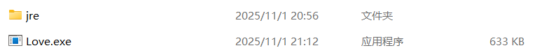
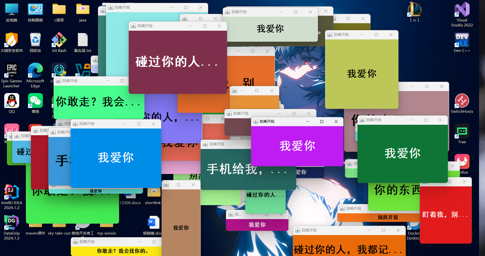
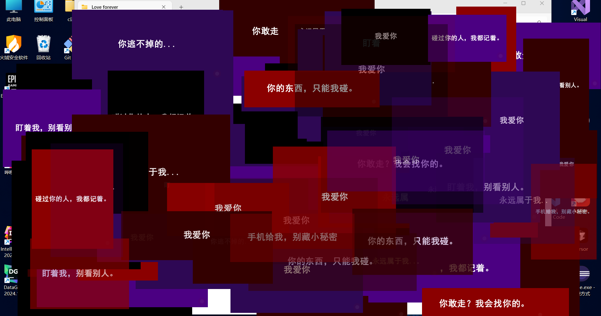

# 永远属于我

一个基于 Java Swing 的趣味娱乐程序，会自动生成大量带有病娇风格文本的随机窗口，营造独特的视觉氛围。

## 程序简介

这是一个轻量级的桌面小程序，运行后会不断生成风格统一但大小、位置随机的窗口，每个窗口会逐字显示预设的病娇主题文本，并带有渐入效果和细节装饰。主窗口提供简单的控制功能，适合作为整蛊或趣味展示工具。

## 功能特点

- **病娇主题设计**：采用深红、暗紫、黑系渐变配色，贴合病娇风格视觉感受
- **随机窗口特性**：每个窗口的大小、位置、背景色随机生成，避免重复感
- 动态效果：
  - 窗口渐入显示（从透明到不透明）
  - 文本逐字打印效果（模拟打字机节奏）
  - 窗口内隐藏心形纹理和动态瞳孔效果
- **防关闭机制**：生成的子窗口无法通过常规关闭按钮关闭，增强 "无法摆脱" 的主题感
- **数量控制**：最多同时显示 100 个窗口，自动清理最早生成的窗口避免资源占用过多
- **简单控制**：主窗口提供 "别走" 按钮可临时停止生成新窗口

## 运行环境

- JDK 17 

- 支持 Swing 的操作系统（Windows/macOS/Linux 均可）

  ## 如何运行

  1. 电脑如果安装了java环境直接运行 .exe 文件即可;
  2. 电脑中无java环境则到 [Releases 页面](https://github.com/YangFang1999/Love-Forever/releases) 下载 `jre.zip` 并解压,将解压出的 `jre` 文件夹和 .exe 文件放在<u>同一根目录</u>下,然后运行.exe文件即可

  ## 效果展示

  1. 版本一

     

  2. 版本二

     

  ## 注意事项

  - 程序运行时会生成大量窗口，可能暂时影响桌面操作，如需停止生成，点击主窗口的 "别走" 按钮(如果找得到的话)
  - 若需彻底关闭所有窗口，关闭主窗口即可（主窗口可正常关闭）
  - 极端情况下若窗口残留，可通过任务管理器结束 Java 进程
  - 本程序仅为娱乐用途，请勿用于干扰他人正常使用设备

  ## 免责声明

  本程序仅作为编程练习和趣味工具开发，开发者不对因使用本程序造成的任何损失（包括但不限于设备故障、数据丢失、操作干扰等）承担责任，使用前请确保获得设备使用者许可。

  ------

  "永远属于我..."